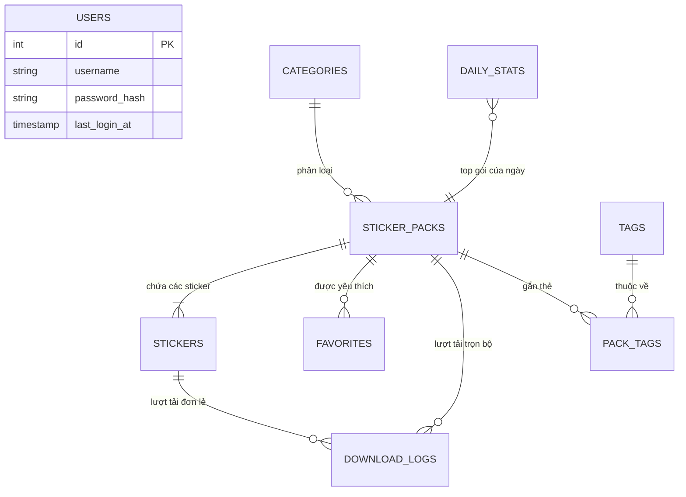

# 🎨 THIẾT KẾ CƠ SỞ DỮ LIỆU - HỆ THỐNG STICKERHUB

> **Dự án:** Nền tảng chia sẻ & quản lý Sticker - **StickerHub**  
> **Nguồn phân tích:** Phân tích giao diện 13 tệp HTML trong `templates/` (Admin & User)  
> **Kiến trúc:** Cơ sở dữ liệu quan hệ (RDBMS - MySQL / PostgreSQL / SQLite)  
> **Phiên bản tài liệu:** `v1.1.0`  
> **Ngày cập nhật:** 27/10/2026  

---

## 📑 MỤC LỤC
1. [Tổng quan hệ thống & Bản đồ ánh xạ](#1-tổng-quan-hệ-thống--bản-đồ-ánh-xạ)
2. [Sơ đồ quan hệ thực thể (ERD Diagram)](#2-sơ-đồ-quan-hệ-thực-thể-erd-diagram)
3. [Quy chuẩn định dạng & Kiểu dữ liệu (Data Dictionary)](#3-quy-chuẩn-định-dạng--kiểu-dữ-liệu)
4. [Chi tiết cấu trúc 9 Bảng dữ liệu](#4-chi-tiết-cấu-trúc-9-bảng-dữ-liệu)
   - 4.1. [users (Tài khoản & Quản trị viên)](#41-bảng-users-tài-khoản--quản-trị-viên)
   - 4.2. [categories (Danh mục chủ đề)](#42-bảng-categories-danh-mục-chủ-đề)
   - 4.3. [sticker_packs (Bộ sưu tập sticker)](#43-bảng-sticker_packs-bộ-sưu-tập-sticker)
   - 4.4. [stickers (Kho sticker đơn lẻ)](#44-bảng-stickers-kho-sticker-đơn-lẻ)
   - 4.5. [tags & pack_tags (Từ khóa tìm kiếm)](#45-bảng-tags--pack_tags-từ-khóa-tìm-kiếm)
   - 4.6. [hero_banners (Băng rôn slider trang chủ)](#46-bảng-hero_banners-băng-rôn-slider-trang-chủ)
   - 4.7. [download_logs (Nhật ký tải về)](#47-bảng-download_logs-nhật-ký-tải-về)
   - 4.8. [favorites (Danh sách yêu thích)](#48-bảng-favorites-danh-sách-yêu-thích)
   - 4.9. [daily_stats (Báo cáo KPI theo ngày)](#49-bảng-daily_stats-báo-cáo-kpi-theo-ngày)
5. [Bảng ma trận quan hệ & Ràng buộc toàn vẹn](#5-bảng-ma-trận-quan-hệ--ràng-buộc-toàn-vẹn)
6. [Kịch bản khởi tạo SQL DDL hoàn chỉnh](#6-kịch-bản-khởi-tạo-sql-ddl-hoàn-chỉnh)

---

## 1. TỔNG QUAN HỆ THỐNG & BẢN ĐỒ ÁNH XẠ

Cơ sở dữ liệu được thiết kế bám sát 100% các thành phần UI/UX đã xây dựng trên các tệp giao diện:

| Phân hệ | Màn hình giao diện HTML | Bảng dữ liệu liên quan |
| :--- | :--- | :--- |
| **Admin** | [login.html](file:///d:/starup/web/Sticker/templates/admin/login.html) | `users` |
| **Admin** | [dashboard.html](file:///d:/starup/web/Sticker/templates/admin/dashboard.html) | `daily_stats`, `sticker_packs`, `categories`, `download_logs` |
| **Admin** | [danhmuc.html](file:///d:/starup/web/Sticker/templates/admin/danhmuc.html) | `categories` |
| **Admin** | [bosuutap.html](file:///d:/starup/web/Sticker/templates/admin/bosuutap.html) | `sticker_packs`, `categories`, `pack_tags`, `tags` |
| **Admin** | [khosticker.html](file:///d:/starup/web/Sticker/templates/admin/khosticker.html) | `stickers`, `sticker_packs`, `categories` |
| **Admin** | [chitietsticker.html](file:///d:/starup/web/Sticker/templates/admin/chitietsticker.html) | `sticker_packs`, `stickers` |
| **Admin** | [thongke.html](file:///d:/starup/web/Sticker/templates/admin/thongke.html) | `daily_stats`, `download_logs`, `sticker_packs` |
| **User** | [index.html](file:///d:/starup/web/Sticker/templates/index.html) | `hero_banners`, `categories`, `sticker_packs`, `tags` |
| **User** | [bosuutap.html](file:///d:/starup/web/Sticker/templates/user/bosuutap.html) | `sticker_packs`, `categories`, `favorites` |
| **User** | [sticker_chitiet.html](file:///d:/starup/web/Sticker/templates/user/sticker_chitiet.html) | `sticker_packs`, `stickers`, `favorites`, `download_logs` |
| **User** | [toptainhieu.html](file:///d:/starup/web/Sticker/templates/user/toptainhieu.html) | `sticker_packs`, `categories`, `download_logs` |

---

## 2. SƠ ĐỒ QUAN HỆ THỰC THỂ (ERD DIAGRAM)



---

## 3. QUY CHUẨN ĐỊNH DẠNG & KIỂU DỮ LIỆU

Nhằm đảm bảo dữ liệu chuẩn hóa, các trường trạng thái được quy ước giá trị cố định (Enum):

- **Trạng thái xuất bản (`status`):**
  - `'active'`: Đang công khai hiển thị trên trang chủ và danh mục.
  - `'pending'`: Chờ ban quản trị duyệt xuất bản.
  - `'hidden'`: Tạm ẩn hoặc lưu nháp, chỉ admin mới thấy trong trang quản trị.
- **Định dạng file sticker (`format`):**
  - `'svg'`: Vector đồ họa chất lượng cao không vỡ nét (mặc định).
  - `'png'`: Ảnh nền trong suốt độ phân giải cao.
  - `'webp'`: Ảnh nén tối ưu dung lượng web hiện đại.
- **Loại hình tải về (`download_type`):**
  - `'zip'`: Tải trọn bộ sưu tập đóng gói nén ZIP.
  - `'single'`: Tải xem trước từng sticker riêng lẻ.
- **Nền tảng đích (`platform`):**
  - `'web'`, `'zalo'`, `'telegram'`, `'whatsapp'`.

---

## 4. CHI TIẾT CẤU TRÚC 9 BẢNG DỮ LIỆU

---

### 4.1. Bảng `users` (Tài khoản Quản trị viên Admin)

- **Mục đích:** Chỉ phục vụ xác thực đăng nhập bảng điều khiển quản trị `admin/login.html`. Hệ thống không yêu cầu người dùng cuối tạo tài khoản.
- **Khóa chính:** `id` (Tự tăng).

| Tên cột | Kiểu dữ liệu | Khóa / Chỉ mục | Mặc định | Chấp nhận NULL | Ý nghĩa & Mô tả |
| :--- | :--- | :---: | :---: | :---: | :--- |
| `id` | `INT` | **PK** | *Auto* | ❌ NO | Định danh quản trị viên duy nhất |
| `username` | `VARCHAR(50)` | **UNIQUE** | | ❌ NO | Tên đăng nhập (vd: `admin`) |
| `password_hash` | `VARCHAR(255)` | | | ❌ NO | Mật khẩu mã hóa bảo mật (bcrypt / argon2) |
| `last_login_at` | `TIMESTAMP` | | `NULL` | ⚠️ YES | Thời điểm đăng nhập gần nhất |
| `created_at` | `TIMESTAMP` | | `CURRENT_TIMESTAMP` | ❌ NO | Thời điểm khởi tạo tài khoản |
| `updated_at` | `TIMESTAMP` | | `CURRENT_TIMESTAMP` | ❌ NO | Thời điểm cập nhật cuối |

#### Dữ liệu mẫu (Sample Data):
```json
{
  "id": 1,
  "username": "admin",
  "password_hash": "$2b$12$e8Y6/kR... (bcrypt hash)",
  "last_login_at": "2026-10-27 10:30:00"
}
```

---

### 4.2. Bảng `categories` (Danh mục chủ đề)

- **Mục đích:** Quản lý 8 nhóm chủ đề phân loại sticker trên trang chủ, sidebar và `admin/danhmuc.html`.
- **Khóa chính:** `id` (Tự tăng).

| Tên cột | Kiểu dữ liệu | Khóa / Chỉ mục | Mặc định | Chấp nhận NULL | Ý nghĩa & Mô tả |
| :--- | :--- | :---: | :---: | :---: | :--- |
| `id` | `INT` | **PK** | *Auto* | ❌ NO | Mã định danh danh mục |
| `name` | `VARCHAR(100)` | | | ❌ NO | Tên tiếng Việt (vd: `Động vật`, `Anime & Manga`) |
| `slug` | `VARCHAR(100)` | **UNIQUE** | | ❌ NO | Mã định danh URL (vd: `animals`, `anime`, `chibi`) |
| `icon_name` | `VARCHAR(50)` | | `'tag'` | ❌ NO | Tên Lucide icon (vd: `paw-print`, `zap`, `heart`) |
| `badge_bg_class`| `VARCHAR(50)` | | `NULL` | ⚠️ YES | Mã class màu badge CSS (vd: `badge-bg-1`) |
| `description` | `VARCHAR(255)` | | `NULL` | ⚠️ YES | Mô tả tóm tắt nội dung chủ đề |
| `sort_order` | `INT` | **INDEX** | `0` | ❌ NO | Thứ tự sắp xếp hiển thị (1..8..) |
| `status` | `VARCHAR(20)` | **INDEX** | `'active'` | ❌ NO | `'active'` (Công khai), `'hidden'` (Tạm ẩn) |
| `created_at` | `TIMESTAMP` | | `CURRENT_TIMESTAMP` | ❌ NO | Thời điểm khởi tạo |
| `updated_at` | `TIMESTAMP` | | `CURRENT_TIMESTAMP` | ❌ NO | Thời điểm cập nhật cuối |

#### Dữ liệu mẫu (Sample Data):
```json
{
  "id": 1,
  "name": "Động vật",
  "slug": "animals",
  "icon_name": "paw-print",
  "badge_bg_class": "badge-bg-1",
  "description": "Chó mèo dễ thương, thú cưng hài hước",
  "sort_order": 1,
  "status": "active"
}
```

---

### 4.3. Bảng `sticker_packs` (Bộ sưu tập sticker)

- **Mục đích:** Thực thể trọng tâm lưu trữ toàn bộ gói sticker tải về, thống kê lượt tải, đánh giá sao, lượt thích.
- **Khóa chính:** `id` (Tự tăng).
- **Khóa ngoại:** `category_id` (trỏ đến `categories.id`).

| Tên cột | Kiểu dữ liệu | Khóa / Chỉ mục | Mặc định | Chấp nhận NULL | Ý nghĩa & Mô tả |
| :--- | :--- | :---: | :---: | :---: | :--- |
| `id` | `BIGINT` | **PK** | *Auto* | ❌ NO | Mã định danh bộ sưu tập |
| `category_id` | `INT` | **FK, INDEX** | | ❌ NO | Liên kết danh mục cha |
| `code` | `VARCHAR(30)` | **UNIQUE** | `NULL` | ⚠️ YES | Mã hiển thị UI (vd: `#PACK-001`) |
| `title` | `VARCHAR(150)` | **INDEX** | | ❌ NO | Tên bộ sưu tập (vd: `Cute Cats`, `Anime Girls`) |
| `slug` | `VARCHAR(150)` | **UNIQUE** | | ❌ NO | Chuỗi URL thân thiện (vd: `cute-cats`) |
| `author_name` | `VARCHAR(100)` | | | ❌ NO | Tên tác giả hiển thị UI (vd: `MiuMiu Studio`) |
| `description` | `TEXT` | | `NULL` | ⚠️ YES | Đoạn văn mô tả chi tiết nội dung bộ sticker |
| `cover_image` | `VARCHAR(255)` | | | ❌ NO | Đường dẫn ảnh thumbnail cover (`assets/pack_cats.jpg`) |
| `zip_file_url` | `VARCHAR(255)` | | `NULL` | ⚠️ YES | File nén ZIP trọn bộ để người dùng bấm tải |
| `total_stickers`| `INT` | | `0` | ❌ NO | Số lượng sticker có trong gói (vd: `120`) |
| `file_size_mb` | `DECIMAL(6,2)` | | `0.00` | ❌ NO | Tổng dung lượng tệp ZIP tính theo MB (vd: `14.20`) |
| `total_downloads`| `BIGINT` | **INDEX** | `0` | ❌ NO | Tổng lượt tải trọn bộ (phục vụ Top tải nhiều) |
| `total_favorites`| `INT` | | `0` | ❌ NO | Số lượt bấm thả tim yêu thích (vd: `2400`) |
| `total_views` | `BIGINT` | | `0` | ❌ NO | Lượt xem chi tiết gói |
| `rating_avg` | `DECIMAL(3,2)` | | `5.00` | ❌ NO | Điểm đánh giá sao trung bình (1.00 - 5.00) |
| `rating_count` | `INT` | | `0` | ❌ NO | Số lượt người dùng đánh giá (vd: `126`) |
| `is_featured` | `TINYINT(1)` | **INDEX** | `0` | ❌ NO | Đánh dấu vào khối "Bộ sưu tập nổi bật" (1: Có) |
| `featured_order`| `INT` | | `0` | ❌ NO | Thứ tự hiển thị trong khối nổi bật |
| `status` | `VARCHAR(20)` | **INDEX** | `'active'` | ❌ NO | `'active'` (Công khai), `'pending'`, `'hidden'` |
| `published_at` | `TIMESTAMP` | | `NULL` | ⚠️ YES | Thời điểm phát hành ra trang chủ |
| `created_at` | `TIMESTAMP` | | `CURRENT_TIMESTAMP` | ❌ NO | Ngày tạo bản ghi |
| `updated_at` | `TIMESTAMP` | | `CURRENT_TIMESTAMP` | ❌ NO | Ngày cập nhật bản ghi |

#### Dữ liệu mẫu (Sample Data):
```json
{
  "id": 1,
  "category_id": 1,
  "code": "#PACK-001",
  "title": "Cute Cats",
  "slug": "cute-cats",
  "author_name": "MiuMiu Studio",
  "description": "Bộ sticker mèo đáng yêu, với nhiều biểu cảm siêu dễ thương cho hội mê mèo!",
  "cover_image": "assets/pack_cats.jpg",
  "total_stickers": 120,
  "file_size_mb": 14.20,
  "total_downloads": 38500,
  "total_favorites": 2400,
  "rating_avg": 4.80,
  "rating_count": 126,
  "is_featured": 1,
  "status": "active"
}
```

---

### 4.4. Bảng `stickers` (Kho sticker đơn lẻ)

- **Mục đích:** Lưu trữ chi tiết từng sticker (vector/ảnh), hỗ trợ lightbox xem trước và tải lẻ trong `admin/khosticker.html` và `user/sticker_chitiet.html`.
- **Khóa chính:** `id` (Tự tăng).
- **Khóa ngoại:** `pack_id` (trỏ đến `sticker_packs.id` với `ON DELETE CASCADE`).

| Tên cột | Kiểu dữ liệu | Khóa / Chỉ mục | Mặc định | Chấp nhận NULL | Ý nghĩa & Mô tả |
| :--- | :--- | :---: | :---: | :---: | :--- |
| `id` | `BIGINT` | **PK** | *Auto* | ❌ NO | Định danh sticker đơn lẻ |
| `pack_id` | `BIGINT` | **FK, INDEX** | | ❌ NO | Thuộc bộ sưu tập cha nào |
| `title` | `VARCHAR(150)` | **INDEX** | | ❌ NO | Tiêu đề sticker (vd: `Mèo vẫy tay chào`) |
| `file_name` | `VARCHAR(100)` | | | ❌ NO | Tên tệp gốc (vd: `cat_01.svg`) |
| `file_path` | `VARCHAR(255)` | | | ❌ NO | Đường dẫn truy cập file (`assets/stickers/cat_01.svg`) |
| `format` | `VARCHAR(10)` | | `'svg'` | ❌ NO | Định dạng: `'svg'`, `'png'`, `'webp'` |
| `dimensions` | `VARCHAR(20)` | | `'512x512'` | ❌ NO | Kích thước phân giải pixel chuẩn |
| `file_size_kb` | `INT` | | `0` | ❌ NO | Dung lượng tệp tính theo KB |
| `tags` | `VARCHAR(255)` | | `NULL` | ⚠️ YES | Nhãn cảm xúc phục vụ lọc `#vẫy tay`, `#yêu thương` |
| `total_downloads`| `INT` | | `0` | ❌ NO | Lượt tải đơn lẻ của riêng sticker này |
| `sort_order` | `INT` | **INDEX** | `0` | ❌ NO | Số thứ tự sắp xếp trong gói (1..120) |
| `status` | `VARCHAR(20)` | | `'active'` | ❌ NO | Trạng thái hiển thị (`'active'`, `'hidden'`) |
| `created_at` | `TIMESTAMP` | | `CURRENT_TIMESTAMP` | ❌ NO | Ngày tải lên |
| `updated_at` | `TIMESTAMP` | | `CURRENT_TIMESTAMP` | ❌ NO | Ngày cập nhật |

#### Dữ liệu mẫu (Sample Data):
```json
{
  "id": 101,
  "pack_id": 1,
  "title": "Mèo vẫy tay chào",
  "file_name": "cat_01.svg",
  "file_path": "assets/stickers/cat_01.svg",
  "format": "svg",
  "dimensions": "512x512",
  "tags": "vẫy tay, vui vẻ, chào hỏi",
  "total_downloads": 3400,
  "sort_order": 1,
  "status": "active"
}
```

---

### 4.5. Bảng `tags` & `pack_tags` (Từ khóa tìm kiếm)

- **Mục đích:** Quản lý từ khóa, phục vụ ô tìm kiếm gợi ý realtime `searchSuggestions` trên Header.

#### Bảng `tags`
| Tên cột | Kiểu dữ liệu | Khóa / Chỉ mục | Mặc định | Ý nghĩa & Mô tả |
| :--- | :--- | :---: | :---: | :--- |
| `id` | `BIGINT` | **PK** | *Auto* | Mã định danh từ khóa |
| `name` | `VARCHAR(60)` | **UNIQUE** | | Tên từ khóa tiếng Việt hoặc tiếng Anh (vd: `mèo`, `cute`, `luffy`) |
| `slug` | `VARCHAR(60)` | **UNIQUE** | | Slug URL tìm kiếm (vd: `meo`, `cute`, `luffy`) |
| `usage_count` | `INT` | **INDEX** | `0` | Tần suất xuất hiện, đếm số gói đang dùng tag này |

#### Bảng `pack_tags` (Liên kết Nhiều - Nhiều)
| Tên cột | Kiểu dữ liệu | Khóa / Ràng buộc | Ý nghĩa & Mô tả |
| :--- | :--- | :---: | :--- |
| `pack_id` | `BIGINT` | **PK, FK** -> `sticker_packs.id` (CASCADE) | Mã bộ sưu tập |
| `tag_id` | `BIGINT` | **PK, FK** -> `tags.id` (CASCADE) | Mã từ khóa |

---

### 4.6. Bảng `hero_banners` (Băng rôn slider trang chủ)

- **Mục đích:** Quản lý slider ảnh lớn tự động chuyển slide mỗi 6 giây trên `templates/index.html`.
- **Khóa chính:** `id` (Tự tăng).

| Tên cột | Kiểu dữ liệu | Khóa / Chỉ mục | Mặc định | Chấp nhận NULL | Ý nghĩa & Mô tả |
| :--- | :--- | :---: | :---: | :---: | :--- |
| `id` | `INT` | **PK** | *Auto* | ❌ NO | Mã slide |
| `title` | `VARCHAR(150)` | | | ❌ NO | Dòng tiêu đề chính (`Khám phá thế giới Sticker`) |
| `subtitle` | `VARCHAR(255)` | | `NULL` | ⚠️ YES | Dòng phụ đề mô tả bên dưới |
| `image_url` | `VARCHAR(255)` | | | ❌ NO | Đường dẫn tệp ảnh nền (`assets/hero_banner.jpg`) |
| `target_url` | `VARCHAR(255)` | | `NULL` | ⚠️ YES | Link điều hướng khi click nút "Khám phá ngay" |
| `sort_order` | `INT` | **INDEX** | `0` | ❌ NO | Thứ tự hiển thị xoay vòng (0, 1, 2, 3) |
| `status` | `VARCHAR(20)` | | `'active'` | ❌ NO | Trạng thái hiển thị (`'active'`, `'hidden'`) |
| `created_at` | `TIMESTAMP` | | `CURRENT_TIMESTAMP` | ❌ NO | Thời điểm tạo |

---

### 4.7. Bảng `download_logs` (Nhật ký tải về)

- **Mục đích:** Lưu vết thời gian thực mọi thao tác tải xuống để phục vụ trang `admin/thongke.html` và dashboard.
- **Khóa chính:** `id` (Tự tăng).

| Tên cột | Kiểu dữ liệu | Khóa / Chỉ mục | Mặc định | Chấp nhận NULL | Ý nghĩa & Mô tả |
| :--- | :--- | :---: | :---: | :---: | :--- |
| `id` | `BIGINT` | **PK** | *Auto* | ❌ NO | Mã bản ghi tải về |
| `pack_id` | `BIGINT` | **FK, INDEX** | `NULL` | ⚠️ YES | Bộ sưu tập được tải (NULL nếu gói đã xóa) |
| `sticker_id` | `BIGINT` | **FK** | `NULL` | ⚠️ YES | Sticker lẻ được tải (NULL nếu tải cả gói ZIP) |
| `download_type`| `VARCHAR(20)` | | `'zip'` | ❌ NO | Loại hình: `'zip'` (trọn bộ), `'single'` (ảnh lẻ) |
| `ip_address` | `VARCHAR(45)` | | `NULL` | ⚠️ YES | Địa chỉ IP người tải (IPv4/IPv6) |
| `user_agent` | `VARCHAR(255)` | | `NULL` | ⚠️ YES | Trình duyệt / Thiết bị truy cập |
| `platform` | `VARCHAR(30)` | | `'web'` | ⚠️ YES | Nền tảng hướng tới: `'web'`, `'zalo'`, `'telegram'`, `'whatsapp'` |
| `downloaded_at`| `TIMESTAMP` | **INDEX** | `CURRENT_TIMESTAMP` | ❌ NO | Thời điểm thực hiện tải |

---

### 4.8. Bảng `favorites` (Danh sách yêu thích)

- **Mục đích:** Quản lý hành động thả tim tại trang chi tiết `user/sticker_chitiet.html` và hiển thị tab "Yêu thích" trên `user/bosuutap.html`.
- **Khóa chính:** `id` (Tự tăng).

| Tên cột | Kiểu dữ liệu | Khóa / Chỉ mục | Mặc định | Chấp nhận NULL | Ý nghĩa & Mô tả |
| :--- | :--- | :---: | :---: | :---: | :--- |
| `id` | `BIGINT` | **PK** | *Auto* | ❌ NO | Mã định danh lượt thích |
| `pack_id` | `BIGINT` | **FK, INDEX** | | ❌ NO | Bộ sưu tập được thả tim |
| `session_token`| `VARCHAR(100)` | **INDEX** | `NULL` | ⚠️ YES | Token trình duyệt (hỗ trợ lưu thả tim của khách) |
| `created_at` | `TIMESTAMP` | | `CURRENT_TIMESTAMP` | ❌ NO | Thời điểm thả tim |

---

### 4.9. Bảng `daily_stats` (Báo cáo KPI theo ngày)

- **Mục đích:** Bảng cache tổng hợp số liệu mỗi ngày, vẽ biểu đồ đường cong mượt (Smooth Wave Chart) 7 ngày / 30 ngày trên `admin/thongke.html` với thời gian truy vấn dưới `5ms`.
- **Khóa chính:** `id` (Tự tăng).

| Tên cột | Kiểu dữ liệu | Khóa / Chỉ mục | Mặc định | Chấp nhận NULL | Ý nghĩa & Mô tả |
| :--- | :--- | :---: | :---: | :---: | :--- |
| `id` | `BIGINT` | **PK** | *Auto* | ❌ NO | Mã bản ghi thống kê |
| `stat_date` | `DATE` | **UNIQUE** | | ❌ NO | Ngày thống kê (vd: `2026-10-26`) |
| `total_downloads`| `INT` | | `0` | ❌ NO | Tổng số lượt tải phát sinh trong ngày |
| `total_page_views`| `INT` | | `0` | ❌ NO | Lượng truy cập trang web trong ngày |
| `new_packs_count` | `INT` | | `0` | ❌ NO | Số bộ sưu tập mới được duyệt xuất bản |
| `new_stickers_count`| `INT`| | `0` | ❌ NO | Số lượng sticker mới tải lên hệ thống |
| `top_pack_id` | `BIGINT` | | `NULL` | ⚠️ YES | Bộ sưu tập dẫn đầu lượt tải trong ngày |

---

## 5. BẢNG MA TRẬN QUAN HỆ & RÀNG BUỘC TOÀN VẸN

| Bảng nguồn (Con) | Cột khóa ngoại | Bảng đích (Cha) | Khóa chính | Hành vi khi Xóa (ON DELETE) | Hành vi khi Sửa (ON UPDATE) |
| :--- | :--- | :--- | :--- | :--- | :--- |
| `sticker_packs` | `category_id` | `categories` | `id` | `RESTRICT` (Không cho xóa danh mục nếu đang có gói) | `CASCADE` |
| `stickers` | `pack_id` | `sticker_packs` | `id` | `CASCADE` (Xóa gói sticker thì tự động xóa hết sticker con) | `CASCADE` |
| `pack_tags` | `pack_id` | `sticker_packs` | `id` | `CASCADE` (Xóa gói thì xóa liên kết tag) | `CASCADE` |
| `pack_tags` | `tag_id` | `tags` | `id` | `CASCADE` (Xóa tag thì xóa liên kết gói) | `CASCADE` |
| `favorites` | `pack_id` | `sticker_packs` | `id` | `CASCADE` (Xóa gói thì xóa danh sách yêu thích gói đó) | `CASCADE` |
| `download_logs` | `pack_id` | `sticker_packs` | `id` | `SET NULL` (Bảo toàn lịch sử thống kê khi gói bị xóa) | `CASCADE` |
| `download_logs` | `sticker_id` | `stickers` | `id` | `SET NULL` (Bảo toàn lịch sử thống kê khi sticker bị xóa) | `CASCADE` |

---

## 6. KỊCH BẢN KHỞI TẠO SQL DDL HOÀN CHỈNH

Dưới đây là mã SQL chuẩn (tương thích hoàn toàn với **MySQL 8.0+**, **MariaDB**, và dễ dàng chuyển đổi sang **PostgreSQL** hay **SQLite**):

```sql
-- ========================================================
-- 1. BẢNG USERS (CHỈ DÀNH CHO ADMIN ĐĂNG NHẬP)
-- ========================================================
CREATE TABLE IF NOT EXISTS users (
    id INT AUTO_INCREMENT PRIMARY KEY,
    username VARCHAR(50) NOT NULL UNIQUE,
    password_hash VARCHAR(255) NOT NULL,
    last_login_at TIMESTAMP NULL,
    created_at TIMESTAMP NOT NULL DEFAULT CURRENT_TIMESTAMP,
    updated_at TIMESTAMP NOT NULL DEFAULT CURRENT_TIMESTAMP ON UPDATE CURRENT_TIMESTAMP
) ENGINE=InnoDB DEFAULT CHARSET=utf8mb4 COLLATE=utf8mb4_unicode_ci;

-- ========================================================
-- 2. BẢNG CATEGORIES (8 DANH MỤC CHỦ ĐỀ)
-- ========================================================
CREATE TABLE IF NOT EXISTS categories (
    id INT AUTO_INCREMENT PRIMARY KEY,
    name VARCHAR(100) NOT NULL,
    slug VARCHAR(100) NOT NULL UNIQUE,
    icon_name VARCHAR(50) NOT NULL DEFAULT 'tag',
    badge_bg_class VARCHAR(50) NULL,
    description VARCHAR(255) NULL,
    sort_order INT NOT NULL DEFAULT 0,
    status VARCHAR(20) NOT NULL DEFAULT 'active',
    created_at TIMESTAMP NOT NULL DEFAULT CURRENT_TIMESTAMP,
    updated_at TIMESTAMP NOT NULL DEFAULT CURRENT_TIMESTAMP ON UPDATE CURRENT_TIMESTAMP,
    INDEX idx_categories_status_order (status, sort_order)
) ENGINE=InnoDB DEFAULT CHARSET=utf8mb4 COLLATE=utf8mb4_unicode_ci;

-- ========================================================
-- 3. BẢNG STICKER_PACKS (BỘ SƯU TẬP)
-- ========================================================
CREATE TABLE IF NOT EXISTS sticker_packs (
    id BIGINT AUTO_INCREMENT PRIMARY KEY,
    category_id INT NOT NULL,
    code VARCHAR(30) NULL UNIQUE,
    title VARCHAR(150) NOT NULL,
    slug VARCHAR(150) NOT NULL UNIQUE,
    author_name VARCHAR(100) NOT NULL,
    description TEXT NULL,
    cover_image VARCHAR(255) NOT NULL,
    zip_file_url VARCHAR(255) NULL,
    total_stickers INT NOT NULL DEFAULT 0,
    file_size_mb DECIMAL(6,2) NOT NULL DEFAULT 0.00,
    total_downloads BIGINT NOT NULL DEFAULT 0,
    total_favorites INT NOT NULL DEFAULT 0,
    total_views BIGINT NOT NULL DEFAULT 0,
    rating_avg DECIMAL(3,2) NOT NULL DEFAULT 5.00,
    rating_count INT NOT NULL DEFAULT 0,
    is_featured TINYINT(1) NOT NULL DEFAULT 0,
    featured_order INT NOT NULL DEFAULT 0,
    status VARCHAR(20) NOT NULL DEFAULT 'active',
    published_at TIMESTAMP NULL,
    created_at TIMESTAMP NOT NULL DEFAULT CURRENT_TIMESTAMP,
    updated_at TIMESTAMP NOT NULL DEFAULT CURRENT_TIMESTAMP ON UPDATE CURRENT_TIMESTAMP,
    CONSTRAINT fk_packs_category FOREIGN KEY (category_id) REFERENCES categories (id) ON DELETE RESTRICT ON UPDATE CASCADE,
    INDEX idx_packs_category_status (category_id, status),
    INDEX idx_packs_downloads (total_downloads DESC),
    INDEX idx_packs_featured (is_featured, featured_order)
) ENGINE=InnoDB DEFAULT CHARSET=utf8mb4 COLLATE=utf8mb4_unicode_ci;

-- ========================================================
-- 4. BẢNG STICKERS (KHO STICKER VECTOR/ẢNH)
-- ========================================================
CREATE TABLE IF NOT EXISTS stickers (
    id BIGINT AUTO_INCREMENT PRIMARY KEY,
    pack_id BIGINT NOT NULL,
    title VARCHAR(150) NOT NULL,
    file_name VARCHAR(100) NOT NULL,
    file_path VARCHAR(255) NOT NULL,
    format VARCHAR(10) NOT NULL DEFAULT 'svg',
    dimensions VARCHAR(20) NOT NULL DEFAULT '512x512',
    file_size_kb INT NOT NULL DEFAULT 0,
    tags VARCHAR(255) NULL,
    total_downloads INT NOT NULL DEFAULT 0,
    sort_order INT NOT NULL DEFAULT 0,
    status VARCHAR(20) NOT NULL DEFAULT 'active',
    created_at TIMESTAMP NOT NULL DEFAULT CURRENT_TIMESTAMP,
    updated_at TIMESTAMP NOT NULL DEFAULT CURRENT_TIMESTAMP ON UPDATE CURRENT_TIMESTAMP,
    CONSTRAINT fk_stickers_pack FOREIGN KEY (pack_id) REFERENCES sticker_packs (id) ON DELETE CASCADE ON UPDATE CASCADE,
    INDEX idx_stickers_pack_order (pack_id, sort_order)
) ENGINE=InnoDB DEFAULT CHARSET=utf8mb4 COLLATE=utf8mb4_unicode_ci;

-- ========================================================
-- 5. BẢNG TAGS & PACK_TAGS (TỪ KHÓA TÌM KIẾM)
-- ========================================================
CREATE TABLE IF NOT EXISTS tags (
    id BIGINT AUTO_INCREMENT PRIMARY KEY,
    name VARCHAR(60) NOT NULL UNIQUE,
    slug VARCHAR(60) NOT NULL UNIQUE,
    usage_count INT NOT NULL DEFAULT 0,
    INDEX idx_tags_usage (usage_count DESC)
) ENGINE=InnoDB DEFAULT CHARSET=utf8mb4 COLLATE=utf8mb4_unicode_ci;

CREATE TABLE IF NOT EXISTS pack_tags (
    pack_id BIGINT NOT NULL,
    tag_id BIGINT NOT NULL,
    PRIMARY KEY (pack_id, tag_id),
    CONSTRAINT fk_packtags_pack FOREIGN KEY (pack_id) REFERENCES sticker_packs (id) ON DELETE CASCADE ON UPDATE CASCADE,
    CONSTRAINT fk_packtags_tag FOREIGN KEY (tag_id) REFERENCES tags (id) ON DELETE CASCADE ON UPDATE CASCADE
) ENGINE=InnoDB DEFAULT CHARSET=utf8mb4 COLLATE=utf8mb4_unicode_ci;

-- ========================================================
-- 6. BẢNG HERO_BANNERS (SLIDER TRANG CHỦ)
-- ========================================================
CREATE TABLE IF NOT EXISTS hero_banners (
    id INT AUTO_INCREMENT PRIMARY KEY,
    title VARCHAR(150) NOT NULL,
    subtitle VARCHAR(255) NULL,
    image_url VARCHAR(255) NOT NULL,
    target_url VARCHAR(255) NULL,
    sort_order INT NOT NULL DEFAULT 0,
    status VARCHAR(20) NOT NULL DEFAULT 'active',
    created_at TIMESTAMP NOT NULL DEFAULT CURRENT_TIMESTAMP,
    INDEX idx_banners_order (sort_order)
) ENGINE=InnoDB DEFAULT CHARSET=utf8mb4 COLLATE=utf8mb4_unicode_ci;

-- ========================================================
-- 7. BẢNG DOWNLOAD_LOGS (LỊCH SỬ TẢI VỀ)
-- ========================================================
CREATE TABLE IF NOT EXISTS download_logs (
    id BIGINT AUTO_INCREMENT PRIMARY KEY,
    pack_id BIGINT NULL,
    sticker_id BIGINT NULL,
    download_type VARCHAR(20) NOT NULL DEFAULT 'zip',
    ip_address VARCHAR(45) NULL,
    user_agent VARCHAR(255) NULL,
    platform VARCHAR(30) NULL DEFAULT 'web',
    downloaded_at TIMESTAMP NOT NULL DEFAULT CURRENT_TIMESTAMP,
    CONSTRAINT fk_logs_pack FOREIGN KEY (pack_id) REFERENCES sticker_packs (id) ON DELETE SET NULL ON UPDATE CASCADE,
    CONSTRAINT fk_logs_sticker FOREIGN KEY (sticker_id) REFERENCES stickers (id) ON DELETE SET NULL ON UPDATE CASCADE,
    INDEX idx_logs_downloaded_at (downloaded_at)
) ENGINE=InnoDB DEFAULT CHARSET=utf8mb4 COLLATE=utf8mb4_unicode_ci;

-- ========================================================
-- 8. BẢNG FAVORITES (LƯU YÊU THÍCH THEO PHIÊN/SESSION)
-- ========================================================
CREATE TABLE IF NOT EXISTS favorites (
    id BIGINT AUTO_INCREMENT PRIMARY KEY,
    pack_id BIGINT NOT NULL,
    session_token VARCHAR(100) NULL,
    created_at TIMESTAMP NOT NULL DEFAULT CURRENT_TIMESTAMP,
    CONSTRAINT fk_favorites_pack FOREIGN KEY (pack_id) REFERENCES sticker_packs (id) ON DELETE CASCADE ON UPDATE CASCADE,
    INDEX idx_favorites_session (session_token)
) ENGINE=InnoDB DEFAULT CHARSET=utf8mb4 COLLATE=utf8mb4_unicode_ci;

-- ========================================================
-- 9. BẢNG DAILY_STATS (TỔNG HỢP KPI BÁO CÁO)
-- ========================================================
CREATE TABLE IF NOT EXISTS daily_stats (
    id BIGINT AUTO_INCREMENT PRIMARY KEY,
    stat_date DATE NOT NULL UNIQUE,
    total_downloads INT NOT NULL DEFAULT 0,
    total_page_views INT NOT NULL DEFAULT 0,
    new_packs_count INT NOT NULL DEFAULT 0,
    new_stickers_count INT NOT NULL DEFAULT 0,
    top_pack_id BIGINT NULL,
    INDEX idx_stats_date (stat_date DESC)
) ENGINE=InnoDB DEFAULT CHARSET=utf8mb4 COLLATE=utf8mb4_unicode_ci;
```
